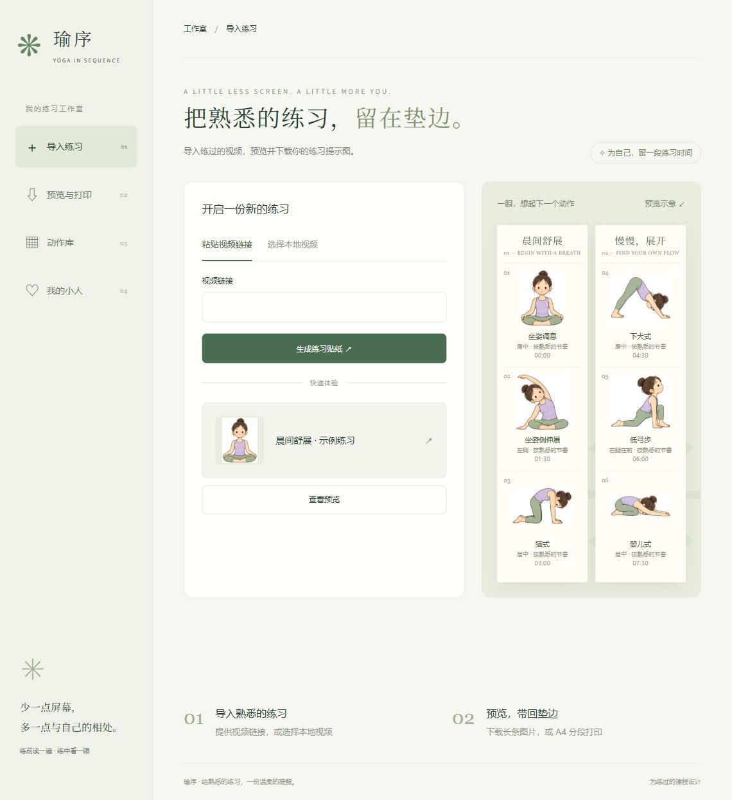
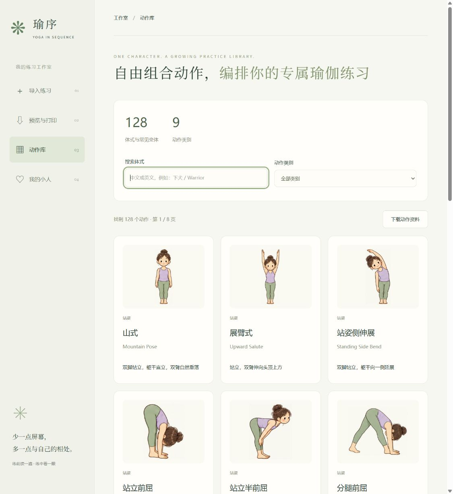

# 瑜序 · Yoga Tape

**把熟悉的练习，留在垫边。**

将瑜伽课程整理成一条可以预览、下载、打印的动作提示贴纸。练习前看一遍，练习中看一眼，减少反复拿起手机的次数。

这是一个持续开发中的本地网页应用，包含课程导入、贴纸预览与打印、动作库，以及可选的专属人物功能。

[快速上手](#快速上手) · [功能一览](#功能一览) · [配置模型](#配置模型) · [当前进度](#当前进度与限制) · [开发说明](#开发说明)



## 功能一览

| 你想做什么 | 从哪里开始 | 当前能力 |
| --- | --- | --- |
| 将练过的课程整理成提示图 | 导入练习 | 本地视频、支持的平台分享链接；按片段识别动作 |
| 将提示图带到瑜伽垫旁 | 预览与打印 | 分段预览、完整长条 PNG、A4 打印或保存 PDF |
| 查找常见瑜伽体式 | 动作库 | 128 个体式与常见变体、9 类动作；中文和英文搜索、分类筛选 |
| 使用自己的小人形象 | 我的小人 | 上传照片生成手绘人物，预览已有形象及已生成体式 |

动作库使用同一套原版小女孩插画：24 张原始参考图，加上 104 张同人物扩展图。每张图单独登记显示范围，避免邻图手脚混入或人物被裁断。



## 快速上手

### 已配置好的 Windows 电脑

1. 双击根目录的 **打开瑜序.cmd**。
2. 浏览器打开后，选择“导入练习”“动作库”或“我的小人”。
3. 生成课程贴纸后，在“预览与打印”下载图片或保存 PDF。

首次在新电脑运行，需要安装 Node.js 22 或更新版本。Windows 双击启动器还需要 PowerShell 7（`pwsh`）。本仓库不是免安装软件包。

### 用命令启动

项目的 Node 服务没有第三方 npm 运行依赖，不需要执行 `npm install`。

```powershell
git clone https://github.com/yuxue-zhang/yoga-tape.git
cd yoga-tape/app
Copy-Item .env.example .env
node --env-file=.env server.mjs
```

已有 `.env` 时跳过复制步骤，避免覆盖自己的配置。启动后访问 **http://127.0.0.1:8787/**。

不配置模型也可以浏览动作库及界面示例。视频分析和专属人物生成需要各自可用的模型连接。

## 配置模型

配置保存在 `app/.env`，只由本机服务读取。复制模板后填入自己账号的信息，不要把完整 Key 写进网页代码或提交到 GitHub。

| 功能 | 配置 |
| --- | --- |
| 百炼视频分析 | `DASHSCOPE_API_KEY`、`BAILIAN_WORKSPACE_ID`、`YOGA_VISION_MODEL`；模板包含免费额度保护开关 |
| 智谱视频分析 | `YOGA_PROVIDER=zhipu`、`ZHIPU_API_KEY`、`YOGA_VISION_MODEL=glm-4.6v-flash` |
| 专属人物生图 | `NEXT_API_KEY`；目前适配代码中指定的第三方兼容绘图接口 |
| 视频切片与抽帧 | 安装 FFmpeg，并将 `YOGA_FFMPEG` 设为 FFmpeg 可执行文件的完整路径 |
| HTTPS 视频直链 | 在 `VIDEO_ALLOWED_HOSTS` 中登记允许的精确域名 |


## 使用流程

### 课程 → 贴纸

粘贴视频分享链接或上传本地视频 → 服务获取并验证视频 → 按片段分析动作 → 匹配动作库 → 查看结果 → 下载 PNG 或打印。

本地视频支持 MP4 / WebM，处理上限为 90 分钟、1 GB。小红书分享链接和 B 站公开链接已有接入，但能否读取受平台页面、登录要求和访问限制影响，并非任意网址均能转换。

### 照片 → 专属人物

在“我的小人”选择清晰的单人正面照片，点击“生成我的小人”。生成结果显示在“人物与动作”，点击“预览人物形象”可放大查看。

当前已验证山式、战士二式、树式三个专属体式样张。仓库不包含用户照片和个人样张，首次克隆不会显示原电脑上的人物记录。

专属人物是独立可选功能。标准课程预览与打印仍使用原版小女孩；人物预览按钮不会启动课程动作生成。

## 当前进度与限制

- **已完成**：四个独立页面、动作库搜索与分类、128 个体式配图、贴纸预览与导出、个人形象及三个体式样张流程。
- **仍在完善**：真实长课程的识别准确率、漏动作检查、不同平台链接的稳定读取。
- 动作库标题中的“自由组合”表达产品方向；当前页面提供浏览、搜索、分类，尚未实现拖拽编排课程。
- 当前分析以画面为依据，没有接入老师语音识别；左右与不确定动作需要人工核对。
- 插画未完成专业瑜伽教师逐项审核，提示贴纸用于回忆已练过的课程。
- 当前是单用户本机应用，没有在线账户、多用户隔离或公网部署流程。

自动化测试验证程序行为，不等同于所有真实视频都能准确识别。

## 数据保存

- 服务仅监听本机 `127.0.0.1:8787`。
- 原视频临时保存在本机；成功处理后删除，失败任务按过期策略清理并支持有效期内续接。
- 浏览器保存最近课程预览；人物素材保存在本机 `app/runtime/characters/`。
- 用户上传照片的本机副本在人物生成成功后删除；桌面原照片不受影响。
- 调用模型时，相应视频画面或照片参考会发送到配置的平台。
- `.env`、运行数据、个人照片、诊断视频和本地工具目录不随仓库上传。

## 开发说明

```text
yoga-tape/
├─ README.md                  项目介绍与启动说明
├─ 打开瑜序.cmd                Windows 启动入口
├─ AGENTS.md                  开发约定
├─ app/
│  ├─ server.mjs              本机服务入口
│  ├─ automation-server.mjs   HTTP 接口与任务路由
│  ├─ generator.mjs           视频处理与分析流程
│  ├─ personal-character.mjs  专属人物生成和本机存储
│  ├─ pose-catalog.json       体式资料
│  ├─ character-assets.json   固定插画与图集边界
│  ├─ dist/                   网页、样式和插画资源
│  ├─ test/                   自动化测试
│  └─ .env.example            配置模板
├─ docs/images/               README 界面截图
└─ handoff/                   早期交接资料与原版参考
```

历史实现记录保留在 `app/` 的各个说明文档中，部分反映早期阶段；当前功能以本 README 和运行代码为准。

### 运行检查

```powershell
cd app
node --test --test-concurrency=1
```

测试使用隔离模型或替身，不需要真实 Key，不消耗模型额度。早期诊断脚本依赖本机测试视频，该类素材未上传。

### 独立功能开发

按功能使用 Git worktree 和 `codex/` 分支：

- `codex/import-practice`：导入练习
- `codex/preview-print`：预览与打印
- `codex/pose-library`：动作库
- `codex/personal-character`：我的小人

在对应目录修改、验证，再集成到可运行版本。密钥和运行目录不随 worktree 自动复制。

## 素材与使用

本仓库用于项目开发归档。未声明统一开源许可证；原版交接资料、插画和第三方参考素材需分别确认使用权限。专业体式名称和分类参考见代码中的来源登记。

